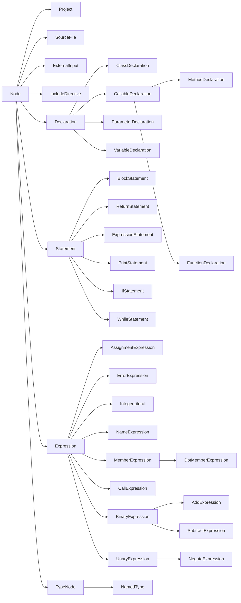

<!-- Typed CPG model: review guide and class hierarchy. MIT License. -->
# Новая иерархия узлов: первый вариант для просмотра

Парсер и проходы работают с типизированным проектом в пакете `com.kniazkov.cpg.model`. [Команды запуска](../README.md) позволяют сохранить исходники и SVG выбранной стадии.

## С чего начать просмотр

1. [Node](../src/main/java/com/kniazkov/cpg/model/Node.java) и [NodeBuilder](../src/main/java/com/kniazkov/cpg/model/NodeBuilder.java): общая основа.
2. [VariableDeclaration](../src/main/java/com/kniazkov/cpg/model/VariableDeclaration.java): обычные поля, необязательные дети, вложенный Builder.
3. [NameExpression](../src/main/java/com/kniazkov/cpg/model/NameExpression.java): ссылка на объявление, которая не является ребёнком.
4. [MethodDeclaration](../src/main/java/com/kniazkov/cpg/model/MethodDeclaration.java) и [CallExpression](../src/main/java/com/kniazkov/cpg/model/CallExpression.java): возможность рекурсивной ссылки вызова на содержащую его функцию.
5. [BuildContext](../src/main/java/com/kniazkov/cpg/model/BuildContext.java) и [EditContext](../src/main/java/com/kniazkov/cpg/model/EditContext.java): сборка и копирование связей.

## Наследование

Для семейств операций показаны примеры листовых классов. Стрелка показывает переход от базового класса к производному. Каждый конечный класс узла имеет собственный `Builder`.



`Declaration` и `Statement` — разные категории. Блок может содержать обе. `ParameterDeclaration` пока тоже относится к общей категории объявлений; проверка конкретного допустимого места параметра будет добавляться при интеграции. Метод и свободная функция наследуют общие поля параметров, типа и тела от `CallableDeclaration`. `CallExpression.target()` может указывать на любой из этих двух видов объявления.

Операции представлены отдельными классами. Например, `AddExpression` и `MultiplyExpression` наследуют операнды и сборку от `BinaryExpression`. `UnaryExpression` объединяет операции с одним операндом. У `MemberExpression` три варианта доступа — через точку, указатель и область видимости. `Language` хранит язык исходного файла. `ErrorExpression` — листовое выражение для отсутствующего или повреждённого инициализатора в диагностическом режиме C++03; оно не имеет вычисляемого значения и не разрешает генерацию ошибочного исходника.

## Контракт класса

```java
VariableDeclaration original = VariableDeclaration.create()
        .setName("count")
        .setType(NamedType.create().setName("int"))
        .setInitializer(IntegerLiteral.create().setValue(10))
        .build();

VariableDeclaration changed = original.edit()
        .setInitializer(IntegerLiteral.create().setValue(20))
        .build();
```

`original` остаётся прежним. Готовые узлы не содержат строителей. Конструкторы конкретных узлов приватные; поля заполняются только внутренним механизмом сборки до возврата результата.

- `create()` возвращает пустой строитель.
- Геттеры готового объекта возвращают обязательное значение, `Optional` или неизменяемый список.
- Геттеры строителя для ещё не заполненного одиночного поля возвращают `Optional`, даже если поле обязательно у готового узла. Например, `builder.left()` и `node.left()` имеют разные типы результата.
- Геттеры списков строителя возвращают неизменяемую копию списка, содержащую доступные для редактирования строители. Сама мутабельная модель от этого не становится неизменяемой.
- `setX(...)` возвращает тот же строитель. Для списков есть `setItems(...)`, `addItem(...)` и аналогичные методы.
- Сеттеры отвергают `null`; необязательные поля очищаются через `clearX()`. Внутреннее отсутствие по-прежнему может храниться как `null`.
- `build()` создаёт новый снимок при каждом вызове. Его данные не зависят от дальнейших изменений строителей и входных коллекций.
- `edit()` копирует достижимые узлы владения и цели ссылок в новое состояние, сохраняя идентичность общих целей и циклы.

`NodeBuilder<T>` в этом варианте — абстрактный класс, а не интерфейс: он централизует final-метод `build()` и хранит `Class<T>` для проверяемого доступа в контексте. Внутренние методы создания оболочки и заполнения недоступны публичному клиенту. Это конкретный вариант реализации для просмотра, а не дополнительное требование к окончательному API.

## Дети и ссылки

`children()` возвращает принадлежащих узлу детей: синтаксис, а у `Project` также `externalInputs()` и их потомков `ExternalInput.inputs()`. `references()` возвращает разрешённые цели дополнительных связей. Несинтаксические записи `Preprocessing` обходятся отдельно; определение внешнего макроса связывается с принадлежащим проекту узлом через `project.externalInput(definition.sourceKey())`. См. [каталог препроцессора](model-guide.ru.md#условная-компиляция-каталог-и-внешние-входы-19). Оба списка неизменяемы и не содержат null. Неразрешённая цель представлена `Optional.empty()` в специальном геттере и не включается в `references()`.

```java
var function = FunctionDeclaration.create().setName("again");

var call = CallExpression.create()
        .setCallee(NameExpression.create()
                .setName("again")
                .setTarget(function))
        .setTarget(function);

function.setBody(BlockStatement.create()
        .addItem(ReturnStatement.create().setValue(call)));

FunctionDeclaration snapshot = function.build();
```

Получается цикл: функция → тело → return → call → ссылка на ту же функцию. Обход `children()` остаётся конечным деревом; обход всех рёбер требует учёта уже посещённых объектов.

Для общей цели ссылки необходимо передавать **тот же экземпляр строителя**. Отдельные вызовы `edit()` или `build()` — независимые операции; они не объединяют объекты по совпадению содержимого. Для редактирования всего проекта следует начинать с `project.edit()`.

## Ошибки разбора и неполный синтаксис (#21)

`SourceFile` хранит неизменяемые `parseProblems()`, необязательную нулевую физическую позицию `stoppedAt()` и `hasErrors()`. Корень `Project.hasErrors()` объединяет состояние файлов. `ParseProblem(code, message, range, skippedText, recovered)` — запись диагностики, не отдельный узел владения. `ErrorExpression.problem()` связывает место отсутствующего/повреждённого выражения с этой записью; узел имеет собственный `Builder` и перегрузку `NodeVisitor`, его `children()` пуст.

Структурно валидный снимок может явно представлять повреждённый исходник: при `int x = ;` сохраняются переменная и `ErrorExpression` с пустым текстом и нулевым диапазоном перед точкой с запятой. Записи сохраняются при `edit().build()`. Это не публикация недостроенной оболочки узла и не обещание корректной программы. Строгий `Cpg.read` по-прежнему не возвращает граф при ошибке; диагностические входы `Cpg.readRecovering` и CLI C++ сохраняют доступный синтаксис, JSON/SVG, но блокируют генерацию исходников и пропускают анализы всего повреждённого проекта. Граница восстановления и схема экспорта описаны в [справочнике](model-guide.ru.md#восстановление-парсера-и-диагностический-экспорт-21).

## Типизированные контексты

`BuildContext` хранит `NodeBuilder<?> → Node` в IdentityHashMap. Метод `copy(NodeBuilder<T>)` возвращает `T`; при повторном посещении используется проверяемый `Class<T>.cast()`. Узел регистрируется до заполнения его связей.

`EditContext` хранит `Node → NodeBuilder<?>`. Конкретный узел создаёт свой вложенный Builder и регистрирует пару через `register(Node, NodeBuilder<?>)` до копирования детей. При регистрации контекст сверяет класс узла с классом, объявленным строителем. Единственный участок с unchecked-приведением находится внутри `EditContext.copy()`: коллекция Java не выражает зависимость типа значения от конкретного ключа. В классах узлов приведений нет.

Контексты package-private и живут только в пределах одной операции. Частично заполненные оболочки не передаются в пользовательские callback и не возвращаются через публичные методы. При исключении контекст отбрасывается целиком.

## Что проверяет сборка

- Наличие обязательных детей и непустых обязательных имён/путей.
- Типы связей: например, цель CallExpression имеет тип CallableDeclaration.
- Базовые категории элементов файла и блока, начальный набор целей присваивания.
- Отсутствие циклов владения и повторного использования одного синтаксического ребёнка в нескольких позициях. Общие цели ссылок разрешены.
- При сборке Project все разрешённые цели должны принадлежать дереву владения этого проекта.

Отдельный узел можно собрать вместе с достижимыми целями ссылок, даже если они не находятся в его собственном поддереве. Это фрагмент графа. При сборке Project действует более строгое правило принадлежности всех узлов проекту.

Это структурная валидация, не проверка программы компилятором. Правила размещения return, типов операндов, имён, модификаторов и языковых версий пока не реализованы. Строители не предназначены для конкурентного изменения; передачу готового графа между потоками следует выполнять с корректной безопасной публикацией. Нефинальные приватные поля не дают гарантий публикации final-полей сами по себе.

## Изменение проекта

`ProjectEditor` принимает исходный снимок. `replace()` назначает замену синтаксического узла и перенаправляет ссылки при копировании. `remove()` удаляет элемент списка после проверки входящих ссылок. `bind()` задаёт цель имени или вызова. `build()` возвращает новый проект с проверенной структурой. Для генерации файлов и адаптации точки входа служит `Cpg.sources(project, language)`.

## Присваивание и Visitor

```java
var assignment = AssignmentExpression.create()
        .setTarget(NameExpression.create().setName("x"))
        .setValue(AddExpression.create()
                .setLeft(IntegerLiteral.create().setValue(2))
                .setRight(IntegerLiteral.create().setValue(3)));
var statement = ExpressionStatement.create().setExpression(assignment).build();

statement.walk(new NodeVisitor() {
    @Override
    public void visit(BinaryExpression operation) {
        System.out.println(operation.getClass().getSimpleName());
    }
});
```

`accept(visitor)` выбирает перегрузку Visitor для одного узла. `walk(visitor)` обходит дерево в глубину, начиная с корня, и посещает детей слева направо. Перегрузки по умолчанию передают управление перегрузке непосредственного родительского класса. В примере обработчик семейства получает узел сложения. При обходе семантические ссылки доступны через `references()`.

## Визуализация DOT

```java
import com.kniazkov.cpg.visualization.DotVisualizer;
import java.nio.file.Path;

// Внутри метода, который обрабатывает IOException и InterruptedException.
DotVisualizer.writeDot(statement, Path.of("tree.dot"));
DotVisualizer.renderSvg(statement, Path.of("tree.svg"));
```

`toDot(root)` возвращает текст графа. Для повреждённого диагностического снимка корень и файлы помечаются как ошибочные, у остановленной единицы показываются физическая позиция и причины, а доступные узлы остаются видимыми. Сплошные стрелки с номерами показывают позиции детей, пунктирные с меткой `ref` ведут к разрешённым объявлениям. При выборе поддерева внешняя цель получает собственную вершину. Генерация DOT работает средствами Java. Для SVG установи Graphviz и проверь `dot -V` в терминале. Визуализатор запускает программу из PATH, на Windows это `dot.exe`. Ошибки запуска и диагностика Graphviz передаются вызывающему коду.

## Правила JavaDoc

Пишем JavaDoc на английском. У интерфейсов и абстрактных классов описываем роль в иерархии и контракт каждого метода. Для точек расширения указываем, кто вызывает метод, что должна сделать реализация и какие инварианты обязана сохранить. У алгоритмов документируем порядок действий и причину выбора этого порядка. Например, регистрация оболочки до обхода ссылок сохраняет идентичность узла при рекурсии.

У листового класса достаточно короткого описания конструкции. Переопределение требует отдельного комментария, когда добавляет существенные условия к унаследованному контракту. Очевидные геттеры и сеттеры отдельных комментариев не требуют.
