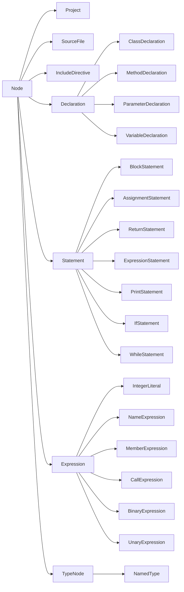

<!-- Typed CPG model: review guide and class hierarchy. MIT License. -->
# Новая иерархия узлов: первый вариант для просмотра

Новые классы находятся в `com.kniazkov.cpg.model`. Существующие `Graph.Node`, `Graph.Draft`, `Graph.Builder`, парсер, проходы и генератор исходников не изменены. Парсер по-прежнему создаёт старую модель. Это реализация структуры новых узлов для обсуждения, а не расширение поддерживаемого синтаксиса.

## С чего начать просмотр

1. [Node](../src/main/java/com/kniazkov/cpg/model/Node.java) и [NodeBuilder](../src/main/java/com/kniazkov/cpg/model/NodeBuilder.java): общая основа.
2. [VariableDeclaration](../src/main/java/com/kniazkov/cpg/model/VariableDeclaration.java): обычные поля, необязательные дети, вложенный Builder.
3. [NameExpression](../src/main/java/com/kniazkov/cpg/model/NameExpression.java): ссылка на объявление, которая не является ребёнком.
4. [MethodDeclaration](../src/main/java/com/kniazkov/cpg/model/MethodDeclaration.java) и [CallExpression](../src/main/java/com/kniazkov/cpg/model/CallExpression.java): возможность рекурсивной ссылки вызова на содержащую его функцию.
5. [BuildContext](../src/main/java/com/kniazkov/cpg/model/BuildContext.java) и [EditContext](../src/main/java/com/kniazkov/cpg/model/EditContext.java): сборка и копирование связей.

## Наследование

Стрелка показывает переход от базового класса к производному. Каждый конечный класс узла имеет собственный `public static final Builder extends NodeBuilder<ЭтотКласс>`.



`Declaration` и `Statement` — разные категории. Блок может содержать обе. `ParameterDeclaration` пока тоже относится к общей категории объявлений; проверка конкретного допустимого места параметра будет добавляться при интеграции. В этом варианте `MethodDeclaration` представляет и метод, и свободную функцию; поле `CallablePlacement` различает их.

Вспомогательные enum: `Language`, `CallablePlacement`, `MemberAccessKind`, `BinaryOperator`, `UnaryOperator`. Типы и модификаторы пока представлены просто: `NamedType` хранит написанное имя, modifiers — неизменяемый список строк. Это не окончательная модель всех языковых вариантов из исследования.

## Контракт класса

```java
VariableDeclaration original = VariableDeclaration.create()
        .setName("count")
        .setType(NamedType.create().setName("int"))
        .setInitializer(IntegerLiteral.create().setValue(10))
        .build();

VariableDeclaration changed = original.edit()
        .setInitializer(IntegerLiteral.create().setValue(20))
        .build();
```

`original` остаётся прежним. Готовые узлы не содержат строителей. Конструкторы конкретных узлов приватные; поля заполняются только внутренним механизмом сборки до возврата результата.

- `create()` возвращает пустой строитель.
- Геттеры готового объекта возвращают обязательное значение, `Optional` или неизменяемый список.
- Геттеры строителя для ещё не заполненного одиночного поля возвращают `Optional`, даже если поле обязательно у готового узла. Например, `builder.left()` и `node.left()` имеют разные типы результата.
- Геттеры списков строителя возвращают неизменяемую копию списка, содержащую доступные для редактирования строители. Сама мутабельная модель от этого не становится неизменяемой.
- `setX(...)` возвращает тот же строитель. Для списков есть `setItems(...)`, `addItem(...)` и аналогичные методы.
- Сеттеры отвергают `null`; необязательные поля очищаются через `clearX()`. Внутреннее отсутствие по-прежнему может храниться как `null`.
- `build()` создаёт новый снимок при каждом вызове. Его данные не зависят от дальнейших изменений строителей и входных коллекций.
- `edit()` копирует достижимые синтаксические узлы и цели ссылок в новое состояние, сохраняя идентичность общих целей и циклы.

`NodeBuilder<T>` в этом варианте — абстрактный класс, а не интерфейс: он централизует final-метод `build()` и хранит `Class<T>` для проверяемого доступа в контексте. Внутренние методы создания оболочки и заполнения недоступны публичному клиенту. Это конкретный вариант реализации для просмотра, а не дополнительное требование к окончательному API.

## Дети и ссылки

`children()` возвращает только синтаксических детей, `references()` — только разрешённые цели дополнительных связей. Оба списка неизменяемы и не содержат null. Неразрешённая цель представлена `Optional.empty()` в специальном геттере и не включается в `references()`.

```java
var function = MethodDeclaration.create()
        .setName("again")
        .setPlacement(CallablePlacement.FUNCTION);

var call = CallExpression.create()
        .setCallee(NameExpression.create()
                .setName("again")
                .setTarget(function))
        .setTarget(function);

function.setBody(BlockStatement.create()
        .addItem(ReturnStatement.create().setValue(call)));

MethodDeclaration snapshot = function.build();
```

Получается цикл: функция → тело → return → call → ссылка на ту же функцию. Обход `children()` остаётся конечным деревом; обход всех рёбер требует учёта уже посещённых объектов.

Для общей цели ссылки необходимо передавать **тот же экземпляр строителя**. Отдельные вызовы `edit()` или `build()` — независимые операции; они не объединяют объекты по совпадению содержимого. Для редактирования всего проекта следует начинать с `project.edit()`.

## Типизированные контексты

`BuildContext` хранит `NodeBuilder<?> → Node` в IdentityHashMap. Метод `copy(NodeBuilder<T>)` возвращает `T`; при повторном посещении используется проверяемый `Class<T>.cast()`. Узел регистрируется до заполнения его связей.

`EditContext` хранит `Node → NodeBuilder<?>`. Конкретный узел создаёт свой вложенный Builder и регистрирует пару через типизированный `register(T, NodeBuilder<T>)` до копирования детей. Соответствие проверяется также по классу узла. Единственный участок с unchecked-приведением находится внутри `EditContext.copy()`: коллекция Java не выражает зависимость типа значения от конкретного ключа. В классах узлов приведений нет.

Контексты package-private и живут только в пределах одной операции. Частично заполненные оболочки не передаются в пользовательские callback и не возвращаются через публичные методы. При исключении контекст отбрасывается целиком.

## Что проверяет сборка

- Наличие обязательных детей и непустых обязательных имён/путей.
- Типы связей: например, цель CallExpression имеет тип MethodDeclaration.
- Базовые категории элементов файла и блока, начальный набор целей присваивания.
- Отсутствие циклов владения и повторного использования одного синтаксического ребёнка в нескольких позициях. Общие цели ссылок разрешены.
- При сборке Project все разрешённые цели должны принадлежать синтаксическому дереву этого проекта.

Отдельный узел можно собрать вместе с достижимыми целями ссылок, даже если они не находятся в его собственном поддереве. Это фрагмент графа. При сборке Project действует более строгое правило принадлежности всех узлов проекту.

Это структурная валидация, не проверка программы компилятором. Правила размещения return, типов операндов, имён, модификаторов и языковых версий пока не реализованы. Строители не предназначены для конкурентного изменения; передачу готового графа между потоками следует выполнять с корректной безопасной публикацией. Нефинальные приватные поля не дают гарантий публикации final-полей сами по себе.

## Что оставлено на следующие шаги

- Генерация исходников и вычисление поддерживаемых языков для новой модели. Заглушек, возвращающих фиктивный результат, нет.
- Адаптация парсера, проходов и преобразование между старой и новой моделями.
- Полная типовая модель, особенности языковых версий и все конструкции из исследования.
- Операции замены/удаления с автоматическим обслуживанием входящих ссылок. Текущие сеттеры строителей меняют только явно указанную связь; это ещё не редактор всего графа.
- Идентификаторы узлов, исходные позиции, дополнительные правила валидации и расширенные diagnostics.

Проверка этого варианта: компиляция старых и новых main-классов вместе с `javac --release 21 -Xlint:all`. У новых классов предупреждений нет; у существующего ParseException остаётся предупреждение про serialVersionUID. Отдельный временный пример проверил цикл рекурсивного вызова, общую цель двух ссылок, независимость edit/build и неизменяемость списка. Тестовые файлы в репозиторий не добавлялись.
